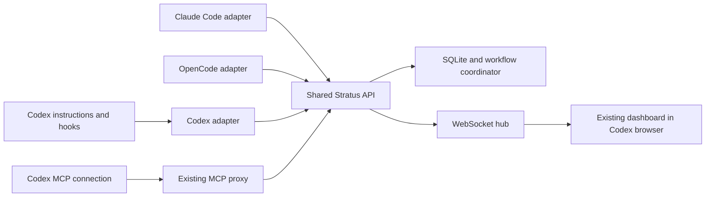

# Standalone Codex adapter for Stratus

Date: 2026-10-20

Status: Scope approved; written specification awaiting review

Scope: First version of a project-local Codex adapter

## Purpose and success criteria

Stratus will support Codex alongside Claude Code and OpenCode. A user working in the Codex desktop app will see workflow phases, task progress, and observed agent activity in the existing live Stratus dashboard, opened beside the conversation. Codex will use the existing memory, retrieval, and orchestration services through MCP.

The adapter will have its own installation assets, instructions, event translation, and hook responses. Claude Code and OpenCode must keep their existing installation targets, commands, workflows, guard behavior, and customized files. Shared services remain the source of truth; there is no second workflow engine or dashboard.

Superpowers governs how development is designed, planned, implemented, and verified. Stratus records that work. The Codex adapter must not introduce a competing approval loop or mark a workflow complete merely because a Codex turn ended.

## Existing boundaries

| Location | Current responsibility | Consequence for this change |
| --- | --- | --- |
| `cmd/stratus/main.go` | CLI, embedded assets, init and refresh | Add a Codex target with separate writer functions and assets |
| `mcp/server.go`, `mcp/tools.go` | Stdio MCP proxy to HTTP API | Reuse transport and tool names; add Codex context without changing legacy defaults |
| `orchestration/coordinator.go`, `orchestration/state.go` | Workflow persistence and valid phase transitions | Extend ownership metadata; preserve the phase graph |
| `db/` | SQLite persistence, sessions, workflow agents, logs | Reuse stores with isolated identities and additive migrations only |
| `hooks/` | Claude event handling, guards, context, transcript parsing | Keep the Claude entry point; do not send Codex payloads through it |
| `cmd/stratus/plugins-opencode/stratus.ts` | OpenCode events and guard implementation | Preserve behavior; make only the runtime filtering change needed for coexistence |
| `api/routes_workflow_agents.go`, `api/agent_transcript.go` | Agent activity and Claude transcript inspection | Reuse normalized persistence, bypass the Claude transcript parser for Codex |
| `frontend/src/`, `api/ws_hub.go` | Shared dashboard and real-time updates | Add runtime-aware presentation and a dashboard-only view |

`parseInitFlags()` currently defaults to `both`, despite older README examples describing a Claude default. The implementation must follow current executable behavior and test it explicitly.

## Selected approach

The selected approach is a standalone adapter above the existing core. A connection consisting only of MCP would provide tools but would not automatically report lifecycle activity. A distributable Codex plugin would add packaging and discovery work that is unnecessary for this first version.

The adapter belongs in a focused `integrations/codex/` Go package. Installation code belongs in `cmd/stratus/codex.go`, with embedded resources under `cmd/stratus/codex-assets/`. Shared orchestration changes must describe ownership or normalized activity, not Codex wire formats.

## Installation and updates

### CLI contract

| Command | Required behavior |
| --- | --- |
| `stratus init --target codex` | Install the Codex adapter in a new or already initialized Stratus project |
| `stratus refresh --target codex` | Update Codex resources and merge its managed configuration entries |
| `stratus init --target claude-code` | Preserve current behavior |
| `stratus init --target opencode` | Preserve current behavior |
| `stratus init --target both` | Continue to mean Claude Code plus OpenCode |
| `stratus init` and `stratus refresh` | Keep the existing default target of `both` |

No `all` target is introduced. Users install Codex alongside an existing integration by selecting `codex` explicitly. No additional `--force` is required to attach Codex to an existing `.stratus.json`.

For an existing project, the Codex target must preserve `.stratus.json` settings, port, data directory, secrets, and existing sync hashes, even when `--force` is supplied. It must not run the legacy configuration reset or unrelated Docker/image setup. In a new project it creates the minimal shared configuration needed by the existing server.

### Generated files and ownership

| Destination | Contents |
| --- | --- |
| `.codex/config.toml` | Managed `mcp_servers.stratus` entry invoking `stratus mcp-serve --runtime codex` |
| `.codex/hooks.json` | Managed Stratus commands invoking `stratus codex-hook <handler>` |
| `.codex/stratus/instructions.md` | Coordination, identity, dashboard, and recovery instructions |
| `.codex/stratus/workflows/{spec,bug,e2e,resume}.md` | Codex-specific workflow reference instructions |

The first version uses hook-injected context and referenced instruction files. It does not install additional `SKILL.md` files into `.claude/skills/` or `.agents/skills/`. OpenCode can discover those locations, so using them for Codex-specific instructions would weaken the intended separation. The adapter also avoids modifying root `AGENTS.md`, which other clients may consume.

`SessionStart` loads a short coordination notice and the path to the relevant workflow reference. These instructions name available capabilities rather than assuming Claude's `Agent`, `AskUserQuestion`, `${CLAUDE_SESSION_ID}`, `/goal`, or `/resume` interfaces. They refer to MCP tools by their discovered names. Superpowers is an existing user-installed capability, not a dependency copied or installed by Stratus.

Codex configuration changes must use a TOML-aware merge that preserves unrelated settings and comments. Reuse the existing three-way asset hash policy for generated instruction files. Hash keys use a new Codex asset prefix, and a Codex refresh preserves every other target's entries.

For hooks, merge only commands owned by Stratus. Preserve user hooks, ordering between user handlers, and explicit disabled settings. If inline Stratus hooks already exist in `.codex/config.toml`, report the conflict instead of installing duplicate JSON hooks. A conflicting MCP entry or invalid configuration produces an actionable error and remains unchanged. Validate all configuration inputs before writing; use atomic replacement per file. A failed partial installation can be rerun safely and must not be reported as successful.

Do not change the user's model, reasoning effort, permissions, trust settings, or multi-agent defaults. Project hooks and MCP require Codex's normal trust/setup flow. The install summary must distinguish files written from capabilities actually active in a new session.

## Workflow identity and isolation

Codex workflow state adds `runtime: "codex"` and `runtime_session_id`, containing the native Codex session ID. For compatibility with existing stores keyed only by session, its existing `session_id` field stores the internal key `codex:<native-session-id>`. Legacy workflow/session IDs remain unchanged. The native ID is never recovered by stripping arbitrary user input; use the explicit metadata when building a resume action.

The Codex MCP proxy receives runtime context from `--runtime codex`; an invocation without this flag retains its current behavior. `SessionStart` exposes the native session ID to the coordinator. The coordinator passes it explicitly when registering or rebinding a workflow. The proxy supplies Codex runtime metadata and normalizes session IDs for registration and dispatch. A Codex registration missing a session ID fails with a clear message; it must not use a literal environment-variable placeholder.

Ownership metadata must be stored atomically with workflow creation, before the first workflow broadcast. Codex agent record IDs are derived deterministically from runtime, native session ID, and native agent ID, so they cannot collide with existing Claude/OpenCode records. Keep the native agent ID in Codex event metadata for diagnostics.

Runtime metadata lives in the existing workflow `state_json` through optional `WorkflowState` fields. Normalized session keys reuse the session store; agent rows reuse `workflow_agents`. Coordinator activity can use a reserved Codex coordinator ID distinct from every native subagent ID. Persist normalized step details as Stratus events referencing workflow and agent IDs; the detail API selects these records for Codex rather than reading transcript paths. New API projections include optional `usage_available`; Codex records without measured usage set it to `false`, while legacy rendering retains its existing behavior.

Codex event resolution uses an explicit workflow ID owned by that session, or exactly one active Codex workflow with that session key. With zero matches it records no workflow activity. With multiple matches it reports ambiguity and assigns nothing. It never falls back to the latest workflow or the only workflow in another runtime. Unknown session or agent identity is shown as unavailable rather than guessed.

Legacy automatic resolution must exclude explicitly marked Codex workflows before applying its existing matching and single-workflow fallback rules. Apply this small filter to the Go hooks, the OpenCode plugin, and legacy MCP dispatch. Preserve their relative selection behavior among legacy workflows. Existing workflows without runtime metadata keep their previous semantics and display behavior; do not relabel historical records as OpenCode or Claude based on inference.

The runtime-aware MCP proxy checks ownership before workflow mutations. A Codex invocation cannot mutate a legacy workflow by supplying its ID, and legacy automatic delegation cannot select a Codex workflow through an explicit prompt label. Shared read-only listing may show all workflows with their runtime metadata. This is routing isolation between adapters, not authentication for the local API.

Add a `bind_workflow_session` MCP tool, backed by the existing workflow session route with additive runtime fields. For Codex, rebinding requires an explicit workflow ID and a Codex-owned workflow. It updates the internal/native session pair atomically. Cross-runtime takeover returns a conflict; runtime migration is outside this version. This route must not let a legacy caller silently rebind an explicitly Codex-owned workflow.

## Codex events and guards

### Translation boundary

`stratus codex-hook` reads Codex JSON on stdin and emits Codex-compatible responses. It resolves configuration from the event's project root, not the shell's incidental directory, and uses the configured Stratus port. It has separate decoding/output functions from `hooks/handler.go`.

The adapter sends normalized telemetry to a new `POST /api/integrations/codex/events` endpoint. The server validates runtime identity and ownership before persisting data. Existing Claude/OpenCode event endpoints keep their current request/response contracts.

The normalized payload carries `event`, native `session_id`, optional `workflow_id`, `turn_id`, native `agent_id`, `agent_type`, `tool_name`, `tool_use_id`, touched `files`, and a bounded summary or final report when provided by the event. Every event requires its kind and native session ID. Subagent lifecycle events also require a native agent ID; tool events require a tool name. A missing tool-event agent ID permits coordinator attribution only when the runtime identifies it as a main-agent call; otherwise attribution is unavailable. The runtime is fixed by the route. Unknown fields are ignored; missing required identity returns a validation error without modifying state. Do not ingest arbitrary transcript files or raw tool output as telemetry.

| Codex event | First-version behavior |
| --- | --- |
| `SessionStart` | Register the namespaced session and provide Codex instructions plus matching workflow context |
| `SubagentStart` | Record an observed agent against an unambiguous owned workflow |
| `PostToolUse` | Record supported tool activity, touched files, and index invalidation after successful edits |
| `SubagentStop` | Close the agent run; persist a supplied report/verdict when available |
| `PreToolUse` | Apply Stratus phase/delegation/write policy to supported, identifiable delivery operations |
| `PermissionRequest` | Report that the workflow is waiting; leave the user's Codex approval mechanism in control |
| `Stop` | End the observed coordinator turn without completing the workflow or forcing a continuation |
| `Interrupt`, `SessionEnd` | Record interruption/end without inventing a successful task or agent result |

Tool adapters must cover Codex's `Bash`/unified exec, `apply_patch`, and native delegation arguments. Parse `apply_patch` paths as patch data; do not treat it as a Claude `Write` payload. Record failed calls as failures when the event provides that information and do not index them as successful writes. Main-agent calls belong to the observed coordinator, not a fabricated delivery subagent.

Use stable event identities when Codex provides them: runtime/session/event/turn/tool-use for tool calls and runtime/session/event/agent for lifecycle events. Persist deduplication receipts with the corresponding state mutation so duplicate delivery does not increment counters or reopen a completed agent. Add a small `integration_event_receipts` table with a unique `(runtime, event_key)` key using the existing additive migration mechanism. Calls without a stable tool-use identity may be displayed but must not contribute to exact counters. Do not infer per-tool agent attribution from the last agent that started.

Late tool events cannot change `done` or `failed` back to `running`. A stop event received before its start may create a terminal record only when it contains sufficient identity and workflow ownership; otherwise it is ignored with a diagnostic. Subsequent duplicate or late starts cannot reopen that record.

### Enforcement and degraded operation

Reuse existing policy decisions only through explicit normalized inputs. Keep Claude hook output and Codex hook output separate. Codex denies supported calls using its documented `PreToolUse` decision format, with a reason explaining the missing workflow or invalid phase. Ordinary exploration and unrelated user work must not acquire a new blanket workflow requirement.

Telemetry failures are best effort: use a one-second HTTP timeout, allow the Codex operation to continue, and expose the telemetry failure locally. Supported guarded delivery calls fail with an actionable denial when workflow ownership or phase cannot be verified; they must not retry indefinitely. Unknown hook schemas permit ordinary operations with a diagnostic and must not be advertised as enforced policy.

Hooks are guardrails for supported tool paths. Hosted tools, missing lifecycle events, and unavailable subagent identity must not be represented as complete monitoring or complete enforcement. No first-version guarantee depends on parsing Codex's evolving transcript format or extracting token counts from it.

## Superpowers and Stratus phase mapping

The Codex coordinator reads the workflow reference appropriate to the task. It registers the workflow before tracked delivery begins, retrieves relevant memory and governance context, and changes phases only through the existing MCP tools.

| Work | Superpowers responsibility | Stratus recording |
| --- | --- | --- |
| Design and planning | Brainstorming, written specification review, implementation plan review | Simple spec stays in `plan`; complex spec uses existing discovery/design/governance phases and returns to `plan` |
| Execution | Approved implementation plan, appropriate TDD and review workflow | `implement`, ordered tasks and explicit completion updates |
| Verification and learning | Evidence before completion; address review findings | `verify`, then `learn`, then `complete` |
| Bug fixing | Diagnose, fix, verify | `analyze`, `fix`, `review`, `complete` |
| E2E work | Use available browser/testing capabilities | `setup`, `plan`, `generate`, `heal`, `complete` |

These mappings do not add phases or bypass the existing transition validator. A human approval is recorded by the coordinator before transitioning into implementation; a hook event is not approval. A review failure follows the existing fix loop. Task completion requires the actual task result, and workflow completion requires verified work, not just a successful hook or closed conversation turn.

Native Codex agents can be observed when available. This version does not port all 14 Claude delivery profiles or force a multi-agent configuration. Delivery roles may be expressed in explicit task briefs; policy applies only when the role and owning workflow can be identified. Users can still execute an approved plan inline.

## Dashboard in the Codex browser

Keep one Svelte application and its current WebSocket connection. Add `?view=dashboard` to hide the embedded PTY pane and its voice/terminal controls, leaving the status overview at full width. In this mode the terminal component must not mount or create a PTY session. The ordinary URL retains the current terminal layout and persisted split ratio.

Codex instructions tell the agent how to obtain the configured local dashboard URL and open it through the host's available native browser capability. This is a host action, not a new Go dependency or hard-coded private Codex tool name. If no browser capability is available, provide a clickable URL. Installation does not open browser tabs or start a second server automatically.

Codex workflows show a Codex badge. Keep legacy workflow labels and actions unchanged. For Codex workflows, show a plain-language continuation instruction naming the workflow ID; do not emit Claude `/resume`, `claude --resume`, or `/goal` actions. An optional CLI `codex resume` shortcut may appear only after its syntax and native session identity are verified against the supported runtime. The first-version acceptance criteria do not require that shortcut.

The API and WebSocket payloads add optional runtime/native-session metadata and expose the same normalized activity used by other clients. Show missing reports or usage as unavailable, not a misleading measured zero. A Codex activity detail view reads normalized events; it does not invoke the Claude JSONL parser. Reconnect uses the existing dashboard-state reload behavior.

The dashboard's agent/skill editor remains an editor for its existing Claude/OpenCode assets. Observed Codex runs appear in workflow activity; do not silently route editor writes into `.codex/`.

## Compatibility and release boundaries

Shared API additions are optional for legacy callers. Existing tool names, required parameters, workflow IDs, stored historical sessions, phase transitions, and existing WebSocket event names remain valid. Newer metadata must survive coordinator updates instead of disappearing during a read-modify-write operation.

Keep legacy generated resources unchanged except for the explicit Codex-workflow filtering required for coexistence. Do not consolidate all installers, rewrite the OpenCode plugin, migrate Claude skills, change swarm execution modes, or add a dependency on browser automation libraries. The existing external Stratus server and binary embedding model remain intact.

Installation must not touch a running user's production data during tests. Use temporary project roots, temporary databases, and isolated API ports. Never direct integration fixtures at the already-running server on port 41777.

## Acceptance and verification

| ID | Required result | Verification |
| --- | --- | --- |
| AC1 | Codex installs into new and existing projects without resetting shared settings | Installer tests with non-default ports, existing secrets represented by fixtures, and other targets' sync hashes |
| AC2 | Repeating init/refresh is safe and preserves user configuration and edited instructions | Merge/conflict/invalid-TOML tests, duplicate-hook checks, three-way hash fixtures |
| AC3 | Claude, OpenCode, `both`, and default behavior retain their existing contracts | Target matrix, generated-file comparisons allowing only the specified filtering change, existing Go hook/installer tests, and executable OpenCode filtering tests |
| AC4 | Codex MCP initializes, lists tools, and uses the correct project's API | Stdio protocol test, explicit runtime-context test, isolated API integration test |
| AC5 | Registration and resume preserve native identity and cannot attach to another runtime | Creation/rebind tests including equal native IDs across clients, conflicts, multiple owned workflows, and missing IDs |
| AC6 | Agent lifecycle, edits, failures, interruption, and waiting reach the correct workflow | Event fixtures from the supported runtime, HTTP/DB tests, duplicate and out-of-order delivery tests |
| AC7 | Supported Codex delivery guards deny invalid phases and keep exploration usable | Input/output contract tests for Bash, apply_patch, delegation, API outage, and unknown schemas |
| AC8 | Browser status updates without manual refresh and dashboard mode starts no terminal | Frontend tests for runtime actions and conditional mounting; isolated browser smoke test with a real WebSocket update |
| AC9 | Completion follows the existing state machine and actual verification | Spec/bug/E2E transition tests, review-failure loop, Stop/SessionEnd non-completion checks |
| AC10 | All three clients coexist after Codex is installed and after it is disabled | Mixed-runtime fixture test plus documented live smoke checks for Claude Code, OpenCode, and Codex |

Run relevant package tests while developing, then `go test ./...`. Existing installer coverage includes `cmd/stratus/plugin_test.go`; `.opencode/package.json` currently defines dependencies but no test script. The implementation must add an executable test for OpenCode's changed runtime filter and record its concrete runner in the implementation plan. If frontend code changes, run `npm run test`, `npm run check`, and `npm run build` under `frontend/`, followed by a Go build that embeds the rebuilt frontend.

Live verification uses a disposable project and verifies actual Codex event payloads, accepted hook decisions, MCP availability, and dashboard updates. If a host does not expose a required event/identity, disable that monitoring capability and state the limit; do not pass AC6 by fabricating events alone. AC10 requires the existing clients as well as Codex; fixture tests alone cannot establish live compatibility.

## Rollout and recovery

Ship the adapter behind the explicit `codex` target. Existing installations receive no Codex files merely by running their current default refresh. Target-specific installer errors must exit unsuccessfully with the affected path and repair action.

To disable the adapter, disable its MCP entry and remove only Stratus-owned Codex hook commands while preserving user configuration. The dashboard and Claude/OpenCode integrations remain available. Restore customized Codex instruction files from the user's version control or backup; never delete them as a side effect of disabling. Additive metadata/receipt tables may remain in SQLite. Older binaries do not require a destructive database downgrade, but users must upgrade again before continuing Codex-owned workflows.

## Evidence and implementation entry checks

Repository behavior above was checked against the current CLI, coordinator, MCP proxy, hook handlers, OpenCode plugin, agent activity route, and frontend. The local binary reports `codex-cli 0.162.0-alpha.17.2`; that identifies the test environment, not a claimed minimum compatible version.

The official sources below establish the supported extension points. Payload coverage and active project trust still require the isolated live checks in AC4, AC6, and AC7.

- [Codex MCP configuration](https://learn.chatgpt.com/docs/extend/mcp?surface=cli): project-scoped MCP configuration and stdio servers.
- [Codex hooks](https://learn.chatgpt.com/docs/hooks): event schemas, hook discovery, output decisions, tool coverage, and trust.
- [Codex skill discovery](https://learn.chatgpt.com/docs/build-skills): repository skill discovery under `.agents/skills/`.
- [Codex subagents](https://learn.chatgpt.com/docs/agent-configuration/subagents): optional native subagent capabilities and project agent definitions.
- [Codex configuration reference](https://learn.chatgpt.com/docs/config-file/config-reference): supported configuration fields; model/permission settings remain user-owned.

Before implementation, review this specification. After approval, create a separate Superpowers implementation plan with concrete tasks, test commands, and the chosen execution method. This document does not authorize product-code changes by itself.
